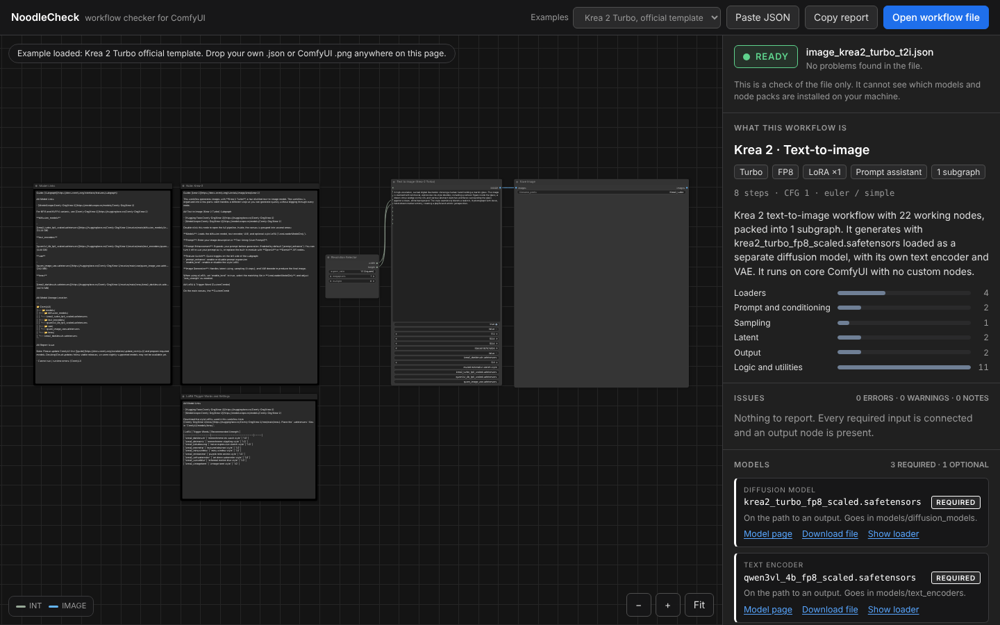
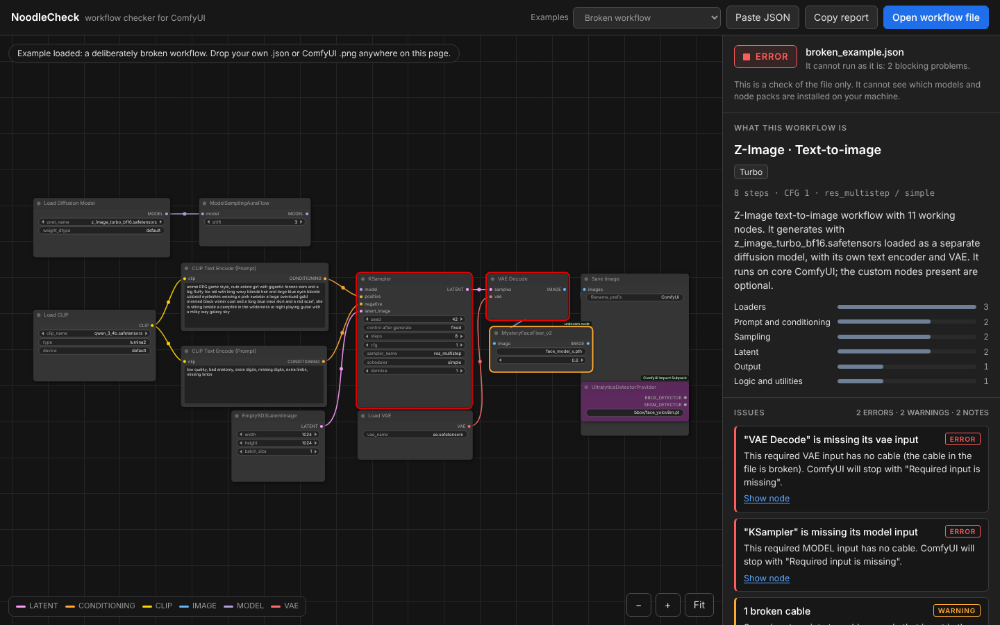
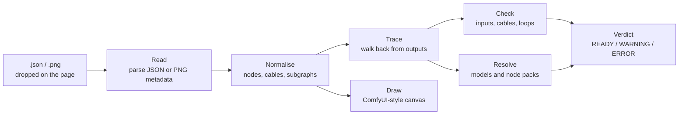

<div align="center">

# 🍜 NoodleCheck

**Drop a ComfyUI workflow. See the noodles. Know if it runs.**

A drag-and-drop workflow checker for ComfyUI that draws your graph, names what it is,
lists every model and custom node it needs, and gives a verdict before you ever hit Run.

[](https://cnthnael.github.io/noodlecheck/)


[**Open NoodleCheck**](https://cnthnael.github.io/noodlecheck/) · [Features](#-features) · [Verdicts](#-verdicts) · [Node detective](#-custom-node-detective) · [Do and don't](#-do-and-dont) · [Roadmap](#-roadmap) · [Credits](#-credits)

<br>



</div>

---

## 📖 Table of contents

- [Why](#-why)
- [Features](#-features)
- [Verdicts](#-verdicts)
- [Custom node detective](#-custom-node-detective)
- [How it works](#-how-it-works)
- [Supported files](#-supported-files)
- [Do and don't](#-do-and-dont)
- [How to use](#-how-to-use)
- [Project structure](#-project-structure)
- [Data snapshot](#-data-snapshot)
- [FAQ](#-faq)
- [Roadmap](#-roadmap)
- [Contributing](#-contributing)
- [Credits](#-credits)
- [License](#-license)

---

## 🤔 Why

You found a workflow you want to try, but you can't open ComfyUI right now:

- 🏢 **You're at work.** No GPU, no ComfyUI, just a browser and five spare minutes.
- 📱 **You're away from your PC.** The workflow is sitting in a Discord message or a Civitai page on your phone.
- 💸 **You're about to rent a GPU pod.** The meter starts the second it boots, and you'd rather not spend the first twenty minutes discovering which models and node packs are missing.

NoodleCheck lets you read the workflow anywhere, with nothing installed. Open it in a browser tab and you know **what it does, which models to download, which node packs to install, and whether the file is even healthy**, so by the time you're at your machine or your pod is up, the shopping list is done.

It runs entirely in the browser. **Your workflow file is never uploaded.**

---

## ✨ Features

| | Feature | What you get |
|---|---|---|
| 🎨 | **ComfyUI-style graph** | Nodes, cables, groups, muted and bypassed nodes drawn with ComfyUI's default dark palette and node sizes. Pan, zoom, click a node for details. |
| 🧩 | **Subgraph navigation** | Open a subgraph the way the ComfyUI frontend does: click the enter button on the node's title bar or double-click it. A breadcrumb trail and `Esc` take you back, nested subgraphs included, and the parent view is restored where you left it. |
| 🏷️ | **Workflow identification** | Model family (Krea 2, FLUX.2, Z-Image, Wan 2.2, SDXL...) and task (text-to-image, image-to-video, inpainting...), plus sampler settings. |
| 📦 | **Model list** | Every model file with its category, target folder, Required or Optional, and a download or search link. |
| 🔌 | **Custom node list** | Every node pack with the node types it provides, Required or Optional, and its repository link. |
| 🔍 | **Custom node detective** | Finds the pack behind a node from its metadata, the ComfyUI-Manager catalogue, near-identical names or name prefixes, with a live catalogue update. |
| 🚦 | **Verdict** | READY, WARNING or ERROR, with each issue linked to the node that caused it, even when that node sits inside a subgraph: the parent gets a dashed outline, the culprit a solid one, and **Show node** jumps straight to it. |
| 🖼️ | **PNG metadata** | Drop an image saved by ComfyUI and the embedded workflow is read straight from it. |
| 📋 | **Copy report** | One click copies the whole analysis as plain text. |
| 🔒 | **Private by design** | No server, no account, no upload. Parsing happens in your tab. |

---

## 🚦 Verdicts

| Level | Meaning | Typical causes |
|---|---|---|
| 🟢 **READY** | Nothing wrong was found in the file. | — |
| 🟠 **WARNING** | It can run, but something needs attention first. | Custom node packs to install · unknown node types · broken cables · mismatched cable types |
| 🔴 **ERROR** | It cannot run as it is. | Corrupted JSON · required input with no cable · cables forming a loop · duplicate node ids · no output node |

<div align="center">

<br><sub>A deliberately broken workflow: failing nodes are outlined, and each issue jumps to its node.</sub>
</div>

### Required vs Optional

NoodleCheck follows the cables **backwards from every output node**.

| Status | When |
|---|---|
| **Required** | The model or node pack sits on a path to an output. |
| **Optional** | It is only used by muted or bypassed nodes, by a branch not connected to any output, or by one side of a switch. |

---

## 🔍 Custom node detective

Workflows don't always say where their nodes come from, so NoodleCheck works through four levels of evidence and tells you which one it used:

| Level | Evidence | Shown as |
|---|---|---|
| 1 | **Named in the file.** The node's own metadata (`cnr_id`, `aux_id`, saved version) names its pack. | Pack with GitHub and Comfy Registry links |
| 2 | **Exact catalogue match.** The node type is listed in the ComfyUI-Manager node map. When several packs define the same name, the one that explains the most nodes in the workflow wins. | Pack marked "best match" |
| 3 | **Near-identical name.** Same name with different capitalisation or punctuation. | Pack with the matched name shown |
| 4 | **Name-prefix family.** No match at all, but the name shares a prefix with a pack's other nodes (`WanVideo…`, `ADE_…`, `LayerUtility:…`). | "Possible source" candidates under the unknown node |

Anything still unidentified gets one-click GitHub code and repository searches.

**Live catalogue.** The node map ships as a snapshot, but the **Update node catalogue** button at the bottom of the side panel downloads the latest ComfyUI-Manager lists straight from GitHub, so newly published packs are recognised without waiting for a new release of this site.

---

## ⚙️ How it works



Everything in that diagram happens in `engine.js` and `index.html`, against a snapshot of ComfyUI data stored in `data.js`.

---

## 📂 Supported files

| Input | Notes |
|---|---|
| Workflow `.json` | The normal export from ComfyUI, including workflows with subgraphs |
| API-format `.json` | Laid out automatically, because that format stores no positions |
| ComfyUI `.png` | Reads the workflow embedded in the image metadata |
| Pasted JSON | `Ctrl+V` anywhere on the page, or the Paste JSON button |

---

## ✅ Do and don't

### Do

- ✅ Check a downloaded workflow **before** loading it, to see what to install first.
- ✅ Use the model and node lists as a shopping list against your own `models/` and `custom_nodes/` folders.
- ✅ Click **Show node** on an issue to jump straight to the problem.
- ✅ Use the **original** `.png` from your ComfyUI output folder when loading from an image.
- ✅ Confirm the file name and source before downloading anything from a search link.

### Don't

- ❌ Don't read READY as "this will run on my machine". NoodleCheck reads the file only. It cannot see your installed models, your node packs, your VRAM or your ComfyUI version.
- ❌ Don't expect it to execute anything. It never runs the workflow, so it cannot catch out-of-memory errors, wrong model and encoder pairings, or bad parameter values.
- ❌ Don't rely on it for missing inputs on custom nodes. Required-input checks only cover ComfyUI core nodes.
- ❌ Don't trust a "best match" pack blindly. When a workflow doesn't record which pack a node came from, the most likely one is picked from the catalogue, and several packs can share node names. "Possible source" candidates are weaker still: they are educated guesses from the node's name.
- ❌ Don't assume an "unknown node" is broken. The built-in data is a snapshot, so newer nodes show as unknown.
- ❌ Don't use screenshots or images sent through chat apps. Those strip the metadata, so no workflow is left inside.

---

## 🖱️ How to use

Nothing to install, nothing to clone. NoodleCheck is a website.

1. Open **<https://cnthnael.github.io/noodlecheck/>** on any device with a browser.
2. Drop a workflow `.json` or a ComfyUI `.png` on the page, or tap **Open workflow file**.
3. Read the verdict and the Models and Custom nodes lists on the right.

That's it. It works the same on a work laptop, a phone or a tablet.

---

## 🗂️ Project structure

```text
noodlecheck/
├── index.html     # Page layout, styles, canvas renderer and side panel
├── engine.js      # Reads the workflow and runs every check
├── data.js        # Snapshot: core node definitions, node pack map, model links
├── samples.js     # The three built-in example workflows
├── favicon.svg    # Browser tab icon
├── docs/          # Screenshots used in this README
└── README.md
```

---

## 🗓️ Data snapshot

The live NoodleCheck is built from these exact versions. The same list is shown at the bottom of the side panel on the site.

| Source | Version | Commit | Date | Used for |
|---|---|---|---|---|
| [ComfyUI](https://github.com/comfyanonymous/ComfyUI) | v0.45.0 | [`0228a9d`](https://github.com/comfyanonymous/ComfyUI/commit/0228a9d73cd7c2daf8f61fe13d56b12efe307171) | 2026-11-10 | Core node definitions, required inputs, model folders, default workflow |
| [ComfyUI_frontend](https://github.com/Comfy-Org/ComfyUI_frontend) | v1.61.0 | [`9b1cc7d`](https://github.com/Comfy-Org/ComfyUI_frontend/commit/9b1cc7d55833f614e24b429d2d44a3b7c19eb0d4) | 2026-11-11 | Dark palette, cable colours, node dimensions |
| [ComfyUI-Manager](https://github.com/Comfy-Org/ComfyUI-Manager) | `main` | [`15e49ea`](https://github.com/Comfy-Org/ComfyUI-Manager/commit/15e49ea544a4b20627c2eec01341843e8c4b6d49) | 2026-11-11 | Node-to-pack map, node pack catalogue, model list |
| [workflow_templates](https://github.com/Comfy-Org/workflow_templates) | `main` | [`26ada70`](https://github.com/Comfy-Org/workflow_templates/commit/26ada70e3eb4d900c023285fe88edd3985ecb8b7) | 2026-11-10 | Model download links, Krea 2 Turbo example, test set |

What that adds up to: **1,020** core node types, **5,720** node packs, **42,491** custom node names and **857** model links. Snapshot built **2026-11-11**.

The node pack catalogue can be refreshed from the page with **Update node catalogue**, which pulls the current `main` of ComfyUI-Manager. The ComfyUI core node list only changes with a new release of this site.

---|---|
| ComfyUI core | **0.45.0** · 1,020 node types |
| ComfyUI-Manager catalogue | 5,720 node packs · 857 model links |
| Snapshot date | **2026-11-11** |

---

## ❓ FAQ

<details>
<summary><b>Is my workflow uploaded anywhere?</b></summary>
<br>
No. The file is parsed inside your browser tab. The only outside request the page makes is loading its typefaces from Google Fonts.
</details>

<details>
<summary><b>It says READY but ComfyUI still shows errors. Why?</b></summary>
<br>
READY means the file is structurally sound. NoodleCheck cannot see what is installed on your machine, so missing model files or node packs on your side still stop the run. Use the Models and Custom nodes lists to check what you need.
</details>

<details>
<summary><b>A node shows as "unknown". Is the workflow broken?</b></summary>
<br>
Not necessarily. It means the node type is not in the ComfyUI core or ComfyUI-Manager snapshot bundled with this version. It may simply be newer than the snapshot date. Press **Update node catalogue** at the bottom of the side panel to fetch the latest list, and check the "Possible source" candidates shown under the node.
</details>

<details>
<summary><b>Why is a model link a search instead of a download?</b></summary>
<br>
A direct link is shown when the workflow itself or the catalogue records where the file comes from. For anything else, such as a personal LoRA, the link is a search by file name on Hugging Face or Civitai.
</details>

<details>
<summary><b>My PNG says "No workflow inside this PNG".</b></summary>
<br>
The image was re-saved, screenshotted or sent through an app that strips metadata. Use the original file from your ComfyUI output folder.
</details>

---

## 🛣️ Roadmap

- [ ] Create, edit and save workflows right in the browser
- [ ] Read workflows embedded in WebP and video files
- [ ] Side-by-side comparison of two workflows
- [ ] Send a workflow straight to a locally running ComfyUI

---

## 🤝 Contributing

Issues and pull requests are welcome. The most useful reports include the workflow file (or a trimmed copy) and what NoodleCheck got wrong: a false error, a wrong model category, or a node matched to the wrong pack.

---

## 🙏 Credits

NoodleCheck is an independent community tool. It is **not affiliated with or endorsed by Comfy Org**.

| Project | Used for | License |
|---|---|---|
| [ComfyUI](https://github.com/comfyanonymous/ComfyUI) by comfyanonymous and contributors | Core node definitions, model folder names, default example workflow | GPL-3.0 |
| [ComfyUI_frontend](https://github.com/Comfy-Org/ComfyUI_frontend) by Comfy Org | Default dark palette, cable colours, node dimensions | GPL-3.0 |
| [ComfyUI-Manager](https://github.com/Comfy-Org/ComfyUI-Manager) by Dr.Lt.Data and contributors | Node-to-pack map, node pack catalogue, model list | GPL-3.0 |
| [workflow_templates](https://github.com/Comfy-Org/workflow_templates) by Comfy Org | Krea 2 Turbo example, model download links, test set | See repository |
| [Inter](https://rsms.me/inter/), [IBM Plex](https://github.com/IBM/plex) | Typefaces, served by Google Fonts | SIL OFL 1.1 |

Built with the help of [Claude](https://claude.ai) by Anthropic.

---

## 📄 License

Released under the **GNU General Public License v3.0**, because `data.js` and `samples.js` contain material derived from GPL-3.0 projects. See [`LICENSE`](LICENSE).

<div align="center">
<br>
<sub>Made for people who would rather check the noodles than chase red nodes.</sub>
</div>
